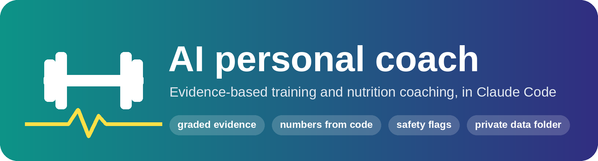
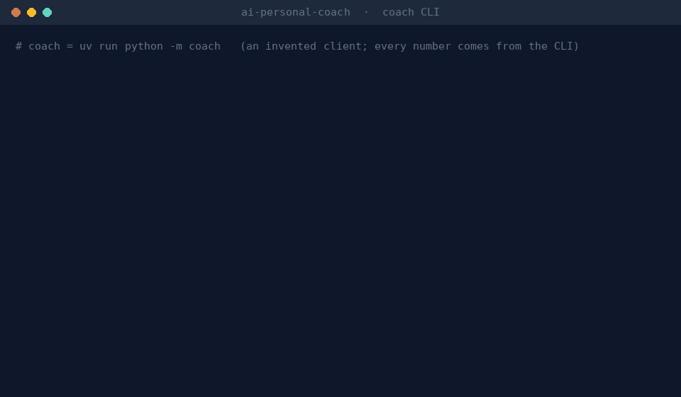
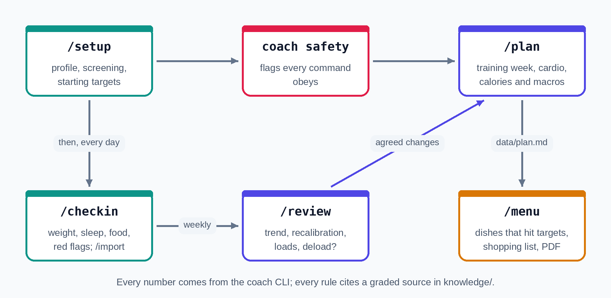
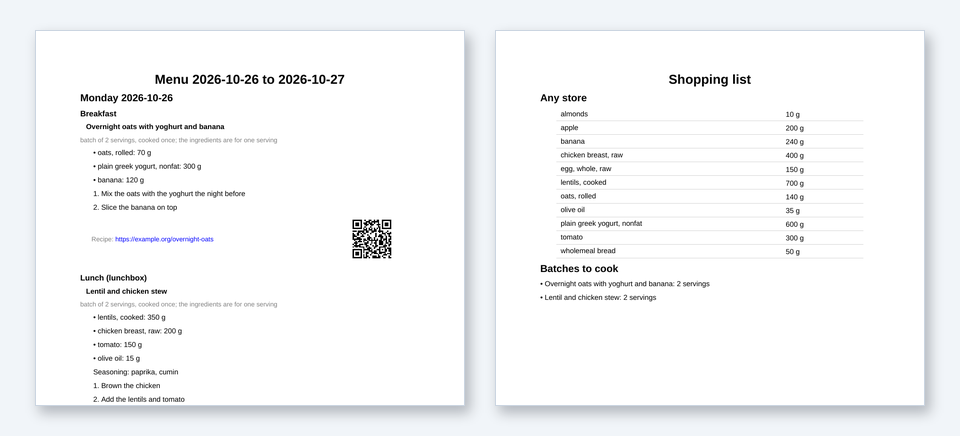

<p align="center">
  
</p>

<p align="center">
  <a href="https://github.com/matgarfer499/ai-personal-coach/actions/workflows/checks.yml"></a>
  
  <a href="https://claude.com/claude-code"></a>
  <a href="LICENSE"></a>
  <a href="LICENSE-CONTENT.md"></a>
</p>

<p align="center"><i>A personal trainer and nutrition coach that shows its sources and never does the maths in its head.</i></p>

An evidence-based personal trainer and nutrition coach that runs inside
[Claude Code](https://claude.com/claude-code). You talk to it in Spanish or English through a few
commands (`/setup`, `/checkin`, `/plan`...). Claude does the conversation; every number (calories,
macros, heart-rate zones, loads, weekly sets, weight trend) comes from a small Python package,
`coach`, so the model never does the arithmetic. Every piece of advice traces back to a graded
rule in `knowledge/` with its sources.

> [!IMPORTANT]
> It is for healthy adults who want a lasting change in body and health. It is not a doctor, a
> dietitian or a therapist: it screens for red flags and hands over to a professional when the
> evidence says so. Read [`docs/safety.md`](docs/safety.md) before using it.

> [!NOTE]
> This is an independent open-source project. It is not affiliated with, endorsed by or
> sponsored by Anthropic; Claude Code is named only because it is the runtime the coach uses.

<p align="center">
  
  <br>
  <sub>An invented client: daily targets, a load increase on the squat, then a red flag in the screening stops training until a clinician clears it. Real CLI output.</sub>
</p>

## Why this one

- **Every number from code.** Calories, macros, zones, loads and the weight trend come from the
  `coach` CLI (`uv run python -m coach ... --json`), with tests, not from the model.
- **Every rule graded and sourced.** Each rule in `knowledge/` is graded strong, moderate or
  emerging and cites the studies or guidelines it rests on; what could not be confirmed is listed in
  [`docs/dropped-claims.md`](docs/dropped-claims.md).
- **Safety flags in code.** The screening (PAR-Q+, warning symptoms, blood pressure, an
  eating-disorder prompt, injuries) sets flags that every command obeys: no deficit after a
  positive screen, no calorie target below the floors, no progression on a lift an injury has
  paused.
- **Your data stays out of git.** Everything you log goes to a folder git ignores, or one you
  choose. The conversation itself goes to your model provider, as in any Claude Code session.
- **Menus you would eat.** Dishes from real recipes and the products you buy, checked against
  your targets, with a shopping list and a printable PDF.

## How you use it

<p align="center">
  
</p>

| Command | Use it to |
|---|---|
| `/setup` | build your profile and screening, get starting targets |
| `/checkin` | log weight, waist, food, sleep and how you feel; it watches for red flags |
| `/import` | add workouts from a Hevy CSV export or a simple spreadsheet CSV |
| `/plan` | get a training week, cardio and nutrition targets, written to `data/plan.md` |
| `/review` | look back at the week and agree on changes |
| `/menu` | build dishes you would enjoy for one or more days, from real recipes and the products you buy, that meet your targets; then a shopping list |
| `/research` | refresh the evidence base on a separate branch for you to review |

`/menu` writes the menu to `data/menus/` and can export it as a PDF, with links (and QR codes)
to the recipes and a shopping list grouped by shop:

<p align="center">
  
</p>

`/menu` can look up supermarket products in [Open Food Facts](https://world.openfoodfacts.org)
(data under the Open Database License). Open Food Facts asks every app for a contact email, so
set `COACH_OFF_CONTACT` to yours (see [Settings](#settings-environment-variables)) before you use
it. Products added this way are marked unverified, and prices are never fetched. The PDF export
needs the optional extra: `uv sync --extra pdf`.

[`docs/examples/`](docs/examples/) has dry runs of `/setup`, `/checkin`, `/import`, `/plan` and
`/review` with an invented client, including three red-flag cases. They were recorded with an
earlier version of the skills, so some outputs differ from today's (see Limitations).

The CLI behind the skills can also be used directly, for example
`uv run python -m coach energy` or `uv run python -m coach --help`.

## Getting started

Requirements: Claude Code, [uv](https://docs.astral.sh/uv/) and Python 3.12.

```
git clone <your private copy> ai-personal-coach
cd ai-personal-coach
uv sync              # or: uv sync --extra pdf, to export menus as PDF
claude
```

Then type `/setup`. It asks about you, runs the screening (PAR-Q+, a short eating-disorder prompt,
warning symptoms, medication, blood pressure) and gives your starting targets.

> [!TIP]
> Make your copy private first (on GitHub: "Use this template" and choose Private), so nothing
> you add can end up public. See [Your data stays private](#your-data-stays-private).

To try every command, including the red-flag cases with invented personas, follow
[`docs/testing-guide.md`](docs/testing-guide.md).

## Your data stays private

Everything about you (profile, screening answers, tastes, check-ins, workouts, plans, menus, reviews) is written
to `data/`, which git ignores. Two ways to keep it that way:

1. **Private copy (recommended).** Make your own private repository from this one (on GitHub:
   "Use this template", or create an empty private repo and push a clone to it). Never make that
   copy public with personal files in it.
2. **Data elsewhere.** Set `COACH_DATA_DIR=/path/outside/the/repo` and the coach reads and writes
   there instead of `data/`. The CLI resolves the folder (`$COACH_DATA_DIR`, else `data/`) and
   `coach profile show` prints it as `data_dir`; the skills use that folder for every file they
   read or write (plan, check-ins, reviews, menus). To use another folder for a single session,
   just tell Claude which one. See [Settings](#settings-environment-variables) for where to set
   the variable so Claude Code sees it.

Do not paste personal data into issues, commits or test fixtures. Test data in `tests/` is
invented.

## Settings (environment variables)

The coach reads two variables from the environment of the commands Claude runs:

| Variable | What for |
|---|---|
| `COACH_DATA_DIR` | folder for your personal data instead of `data/` (see above) |
| `COACH_OFF_CONTACT` | your email, which Open Food Facts requires when `/menu` looks up products |

The most reliable place for them is Claude Code's own `env` setting, in
`.claude/settings.local.json` in this folder. It is a personal file: Claude Code adds it to your
global ignore file the first time it writes it, and this repo's `.gitignore` lists it too.

```json
{
  "env": {
    "COACH_OFF_CONTACT": "you@example.com",
    "COACH_DATA_DIR": "/path/outside/the/repo"
  }
}
```

Restart Claude Code after editing it, and omit `COACH_DATA_DIR` if you keep your data in `data/`.
Check with `! echo $COACH_OFF_CONTACT` inside Claude Code.

A shell alternative is `export COACH_OFF_CONTACT=you@example.com` in `~/.profile`, then start
`claude` from a new login shell. Do not rely on the end of `~/.bashrc`: the default Ubuntu
`.bashrc` returns early for non-interactive shells (the `case $- in` guard at the top), and
those are the shells that run Claude's commands.

## Using it outside Spain

Spain is the only region so far, but most of the coach does not depend on the country:

| Works anywhere | Spain-specific | Not there yet |
|---|---|---|
| Every number (calories, macros, zones, loads, sets, weight trend), the training and safety rules, the knowledge base | the `es` region: Spain-typical foods, the six main chains and their own brands, 112 as the emergency number | languages other than Spanish and English |
| Menus from the general food table (USDA, names in English and Spanish) | | imperial units: height, weight and waist are entered in cm and kg (workout exports in lbs are fine) |
| Your own supermarket products from Open Food Facts, which covers most countries | | a seasonal produce calendar |
| Workout imports (Hevy, any CSV) | | |

What to do, in order:

1. **Leave the region unset.** `/setup` asks your country; with no region for it, it uses the
   general food table and asks which number you call in an emergency (the CLI refuses a region
   that has no folder, so nothing breaks later).
2. **Add the products you buy from Open Food Facts.** In `/menu`, or with
   `coach products search WORD --brand BRAND` and `coach products add BARCODE --chain "YOUR SHOP"`.
   They go into your private catalogue and work in menus and shopping lists. Set
   `COACH_OFF_CONTACT` first ([Settings](#settings-environment-variables)).
3. **Add a region** when you want local foods, your chains and the emergency number built in:
   [`docs/adding-a-region.md`](docs/adding-a-region.md) has a checklist. Supermarket rows copied
   from a chain's website stay in your private copy unless the chain's terms allow publishing
   them.

## Other coding agents

The coach is built for Claude Code, but most of it is plain files any coding agent can use
(Codex, OpenCode, Gemini CLI, Cursor and others). Start the agent at [`AGENTS.md`](AGENTS.md):

- The commands are Markdown files, `.claude/skills/<name>/SKILL.md`. Ask the agent to read and
  follow the one you want (for example `.claude/skills/checkin/SKILL.md`).
- The numbers come from the `coach` CLI, which does not depend on the agent.
- `/research` needs Claude Code: it runs a saved workflow with an independent verifier.
- The `env` block in `.claude/settings.local.json` is read by Claude Code only; with another
  agent, export `COACH_DATA_DIR` and `COACH_OFF_CONTACT` in the shell that starts it.

The skills were written and tested with Claude. With another model, run the red-flag personas in
[`docs/testing-guide.md`](docs/testing-guide.md) before trusting it with your own data.

## Keeping the evidence fresh

Each knowledge file carries an "Evidence checked on" date. When one is older than
`research_reminder_months` (6 by default), `/plan` and `/review` suggest `/research stale`.

`/research` never edits the main branch. It opens a branch `research/<date>-<slug>`, runs a
workflow where one agent searches and opens sources and an independent agent re-opens them and
tries to refute each claim, adds what survives (with sources and grades), records what was
dropped, runs every check (including an online check of each new source against PubMed), writes a
log in `docs/research-log/`, and pushes the branch to your copy's `origin`, so a research topic
never carries your own data. You read the log and the diff and merge it yourself, or not. Arguments: `stale`, a file such as `nutrition.md`, a topic, or `dropped` to
retry claims that earlier research could not confirm.

How the original evidence base was built, and its limits:
[`docs/research-methodology.md`](docs/research-methodology.md).

## Limitations

- **Some protections are instructions, not code.** Asking the screening questions, spotting red
  flags in conversation, naming the right professional and keeping vigorous modalities out of a
  plan depend on the model following the skills. [`docs/safety.md`](docs/safety.md), "What
  protects what", says which is which.
- **Not everything is evidence.** About 40 knowledge rules contain a part labelled as a convention,
  heuristic or product policy, and the code has its own conventions; all are listed in
  [`docs/conventions.md`](docs/conventions.md).
- **Heart-rate bands** follow ACSM 2011 and the GETP 10th edition; the 11th and 12th editions
  could not be checked.
- **Food data** comes from USDA FoodData Central (SR Legacy, frozen in 2018) plus a few
  Spain-specific foods. No supermarket's own product table ships with the template: no chain's
  terms clearly allow redistributing its data, and some (Mercadona, Carrefour, Dia, Alcampo)
  cannot be read without impersonating a browser. Products come from Open Food Facts instead,
  which is crowd-sourced and marked unverified.
- **One region, two languages, metric units:** Spain, Spanish and English, cm and kg (see
  "Using it outside Spain"). There is no seasonal produce calendar yet: the Spanish ministry's
  calendar is the intended source, but its reuse terms could not be confirmed.
- **Millilitres:** products sold per 100 ml go into menus in ml and are never mixed with grams,
  but the coach compares Open Food Facts' pack unit, not the basis of its nutrition table, so a
  product labelled per 100 g and sold in ml can be stored as per 100 ml.
- **Allergies** are matched against menu items by name only, with no synonyms or hidden
  ingredients: read the labels.
- **Known gaps** (tracked as issues): with `no_training` the energy estimate still uses the
  profile's activity level; the dry runs in `docs/examples/` predate the current skills and there
  is no `/menu` one; the `hold` and `paused` paths of `strength progress` are covered by tests but
  have not been seen in a real `/plan` run.

## What is inside

| Folder | What |
|---|---|
| `.claude/skills/` | The commands, one `SKILL.md` each: setup, checkin, import, plan, review, menu, research |
| `coach/` | The numbers: energy and macros, weight trend, zones, strength progression, safety flags, food tables, workout importers, CLI |
| `knowledge/` | 4 rule files (strength and hypertrophy, cardio and health, nutrition, recovery and habits), 459 graded rules, 859 sources; `index.md` lists every rule |
| `foods/`, `regions/es/` | Food composition tables (USDA FoodData Central) and Spain-specific foods; each client's own supermarket products come from Open Food Facts into `data/` |
| `data/` | Your personal data. Ignored by git; only `.gitkeep` is committed |
| `docs/` | Safety, conventions, how the evidence was gathered, dry-run examples, a testing guide |
| `scripts/` | Knowledge checks, index builder, food table builder, `/research` helper |

## Checks

```
uv run pytest                                   # code, skills, docs and knowledge tests
uv run ruff check .
uv run python scripts/check_knowledge.py        # IDs, grades, format, index and README counts
uv run python scripts/build_knowledge_index.py  # after editing knowledge/; also updates the README counts
```

Every number in `coach/` cites the knowledge rule it comes from; numbers no rule gives are marked
`# convention:` and listed in [`docs/conventions.md`](docs/conventions.md).

## Extending it

- Another workout app: [`docs/adding-an-importer.md`](docs/adding-an-importer.md).
- Another country's foods and supermarkets: [`docs/adding-a-region.md`](docs/adding-a-region.md).
- Working on the repo with Claude Code: [`CLAUDE.md`](CLAUDE.md); with another agent:
  [`AGENTS.md`](AGENTS.md).
- Contributing back: [`CONTRIBUTING.md`](CONTRIBUTING.md). Never paste personal data into an issue
  or a pull request.

## Licence

Code (`coach/`, `scripts/`, `tests/`, `.github/`, `.claude/workflows/`) under the MIT licence
([`LICENSE`](LICENSE)); the knowledge base, docs, skill text, images in `assets/` and the other
text files under CC BY 4.0 ([`LICENSE-CONTENT.md`](LICENSE-CONTENT.md)), except the quoted source
passages in `knowledge/sources.md`, which stay under their publishers' copyright. Food values come
from USDA FoodData Central (public domain). Open Food Facts data a user adds stays in their data
directory under the ODbL.
